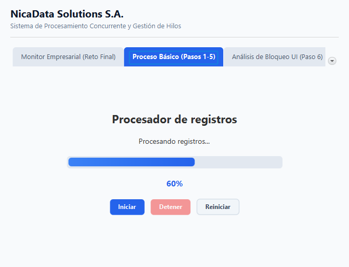
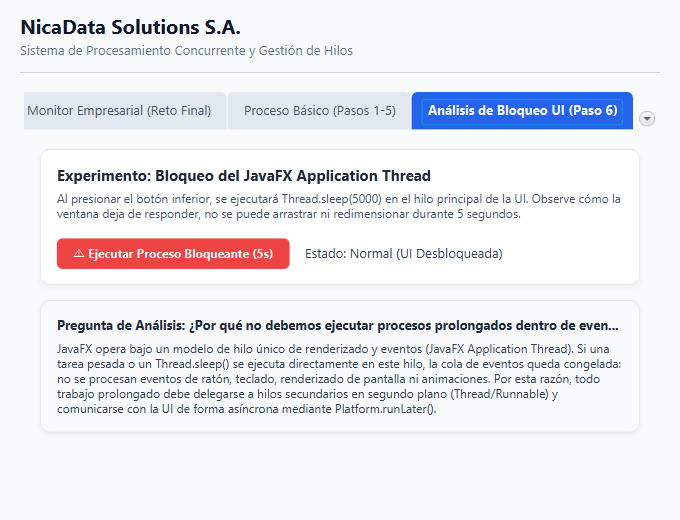
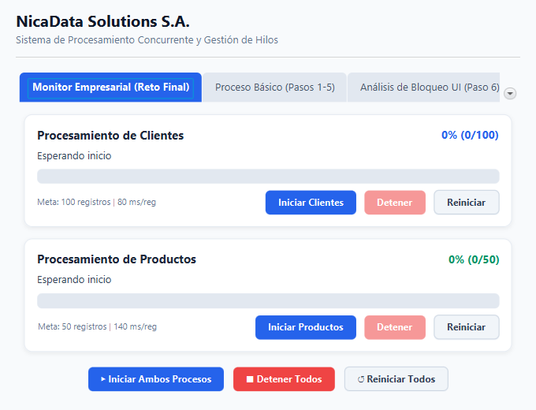
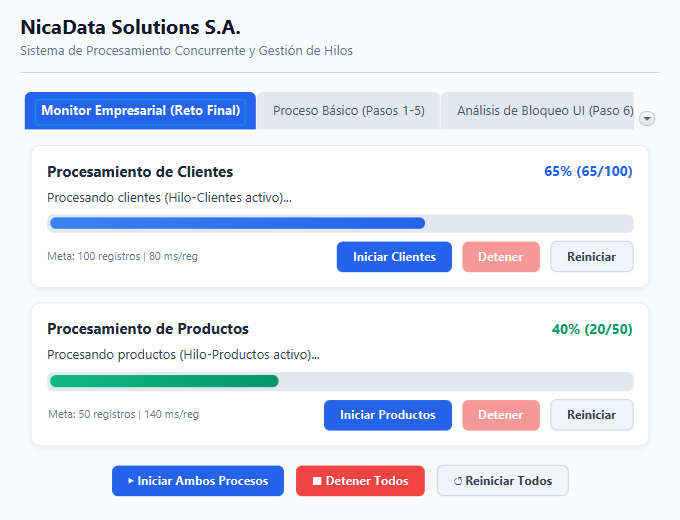
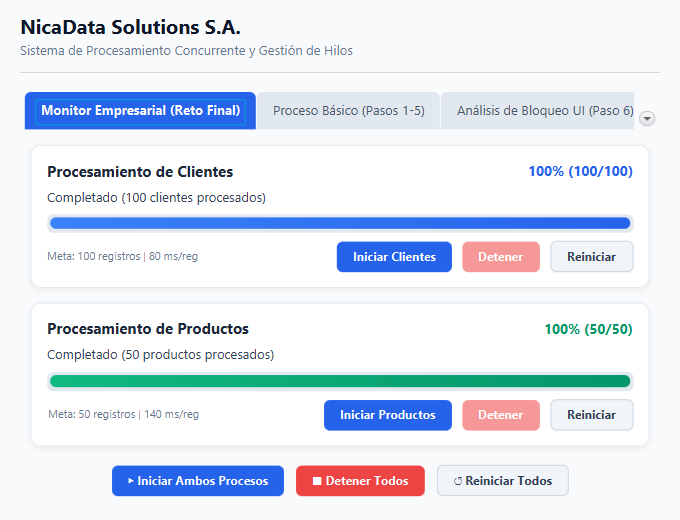

# Práctica Guiada: Hilos en JavaFX
**Universidad Americana (UAM)**  
**Facultad de Ingeniería y Arquitectura**  
**Asignatura:** Programación de Aplicaciones de Escritorio  
**Unidad III:** Programación concurrente  
**Sesión:** 26 — 16/10/2026  
**Tema:** Creación de hilos con `Thread` y `Runnable`  
**Modalidad:** Individual  
**Evaluación:** Formativa, sin puntaje  
**Repositorio:** `JavaFX_Hilos_Practica` / `PracticaHilosJavaFX`  

---

## 1. Resultado de Aprendizaje e Indicadores

* **RA3:** Desarrolla aplicaciones de escritorio con interfaz gráfica que implementan programación concurrente mediante el uso de hilos y mecanismos de sincronización.
* **IL3.1:** Implementa hilos para ejecutar tareas concurrentes dentro de la aplicación.
* **IL3.3:** Gestiona el ciclo de vida y la detención controlada de los hilos durante la ejecución de la aplicación.

---

## 2. Naturaleza del Proyecto: 100% Java Puro (Cero CSS)

> [!IMPORTANT]
> **Arquitectura 100% Java:**  
> La aplicación está construida enteramente en **código Java (JDK 21) utilizando la API de JavaFX**.  
> * **Cero archivos CSS:** No existe ningún archivo `.css` en todo el proyecto.
> * **Cero JavaScript:** Toda la lógica concurrente, contadores y simulación se ejecutan en la JVM con `java.lang.Thread` y `java.lang.Runnable`.
> * **Diseño en Java puro:** Toda la interfaz gráfica, fuentes (`Font`), colores (`Color`), fondos (`Background`) y márgenes (`Insets`) se configuran mediante métodos e instancias de la API de Java en `MainAppPuroJava.java`.

---

## 3. Preservación del Avance al Detener y Continuar

A diferencia de implementaciones que pierden el avance al pausar:
* **Persistencia en memoria:** Cada hilo almacena de forma continua su progreso (`progresoActual`, `progresoClientes`, `progresoProductos`).
* **Detención limpia:** Al hacer clic en **Detener**, se interrumpe el hilo (`interrupt()`) y el porcentaje alcanzado no se reinicia.
* **Continuación inmediata:** Al presionar **Continuar**, el nuevo hilo retoma el procesamiento en `progreso + 1` sin perder el trabajo ya realizado.
* **Reinicio manual:** El avance sólo vuelve a 0% cuando el usuario presiona voluntariamente el botón **Reiniciar** o cuando el proceso completa el 100%.

---

## 4. Conceptos Fundamentales

| Concepto | Tipo / Ámbito | Rol y Descripción Técnica |
| :--- | :--- | :--- |
| **`Thread`** | Clase (`java.lang.Thread`) | Representa una unidad de ejecución concurrente gestionada por la JVM y mapeada a hilos nativos del sistema operativo. |
| **`Runnable`** | Interfaz funcional | Define el contrato del trabajo o tarea ejecutable a través de su método abstracto `run()`. |
| **`start()`** | Método de `Thread` | Solicita al planificador de la JVM la creación y arranque de un nuevo hilo nativo. **Importante:** Llamar directamente a `run()` ejecutaría la tarea secuencialmente en el hilo actual sin crear concurrencia. |
| **`sleep(ms)`** | Método estático de `Thread` | Suspende la ejecución del hilo invocador durante un lapso de tiempo especificado. Permite simular latencias de cómputo; es sensible a señales de interrupción (`InterruptedException`). |
| **`Platform.runLater(Runnable)`** | Método estático de JavaFX | Encola un bloque de código para ser despachado asíncronamente en el **JavaFX Application Thread**. Es la única vía autorizada por el modelo de hilo único (*Single-Threaded Model*) de JavaFX para alterar nodos de la escena gráfica. |
| **`interrupt()`** | Método de `Thread` | Activa la bandera de interrupción en el hilo objetivo. Si el hilo se encuentra bloqueado en `sleep()` o `wait()`, la JVM lo despierta inmediatamente lanzando `InterruptedException`. |
| **`isInterrupted()`** | Método de `Thread` | Consulta el valor de la bandera booleana de interrupción sin modificarla ni restablecerla. |
| **`setDaemon(true)`** | Método de `Thread` | Configura el hilo como demonio (*background worker*). Los hilos demonio son finalizados automáticamente por la JVM si todos los hilos de usuario principales (como el hilo de la UI) han terminado. |

---

## 5. Estructura del Proyecto (100% Java)

```text
PracticaHilosJavaFX/
│
├── .mvn/                                # Configuración de Maven Wrapper
├── docs/
│   └── img/                             # Evidencias visuales de ejecución
│       ├── monitor_inicial.png
│       ├── monitor_concurrente.png
│       ├── monitor_completado.png
│       ├── proceso_basico.png
│       └── bloqueo_ui.png
│
├── src/
│   └── main/
│       ├── java/
│       │   ├── module-info.java         # Descriptor modular Java 21
│       │   └── ni/edu/uam/practicahilos/
│       │       ├── Launcher.java        # Punto de entrada universal (100% Java)
│       │       ├── MainAppPuroJava.java # Aplicación principal 100% Java Puro (Sin FXML, Cero CSS)
│       │       ├── MainApp.java         # Inicializador alternativo con FXML
│       │       ├── ProcesadorController.java # Controlador con persistencia de avance
│       │       └── GeneradorCapturas.java    # Generador automatizado de capturas
│       │
│       └── resources/
│           └── ni/edu/uam/practicahilos/
│               └── procesador-view.fxml # Vista FXML limpia (sin hojas CSS)
│
├── .gitignore
├── mvnw / mvnw.cmd                      # Wrappers Maven multiplataforma
├── pom.xml                              # Configuración Maven (Java 21, JavaFX 21.0.6)
└── README.md                            # Documentación integral de la práctica
```

---

## 6. Implementación de la Guía (Pasos 1 a 5)

En la pestaña **"Proceso Básico (Pasos 1-5)"** se encuentra la implementación del ejercicio guiado:

* **Componentes utilizados:** `lblEstado`, `barraProgreso`, `lblPorcentaje`, `btnIniciar`, `btnDetener`, `btnReiniciar`.
* **Procesamiento:** Itera de 1 a 100 registros con un retardo de `100 ms` por iteración (~10 segundos en total).
* **Persistencia al pausar:** Si el proceso va por el 45% y se presiona **Detener**, la barra permanece en 45%, la etiqueta indica `"Proceso detenido en 45%. Progreso conservado."` y el botón cambia a `"Continuar (45%)"`. Al hacer clic nuevamente, retoma de 46 a 100.
* **Actualización segura:** Se utiliza `Platform.runLater()` en cada iteración para reflejar el progreso de la barra y la etiqueta porcentual.



---

## 7. Análisis de Bloqueo de la Interfaz (Paso 6)

### Código del Experimento
```java
private void procesoBloqueante() {
    lblEstadoBloqueo.setText("Procesando (UI Bloqueada durante 5s)...");

    try {
        // ¡PELIGRO! Esto duerme directamente el JavaFX Application Thread
        Thread.sleep(5000);
    } catch (InterruptedException e) {
        Thread.currentThread().interrupt();
    }

    lblEstadoBloqueo.setText("Finalizado (UI Desbloqueada)");
}
```

### Evidencia Visual del Experimento


### Pregunta de Análisis
> **¿Por qué no debemos ejecutar procesos prolongados directamente dentro de los eventos de JavaFX?**

### Explicación Teórica y Técnica
JavaFX opera bajo un modelo de concurrencia denominado **Single-Threaded Model** (Modelo de Hilo Único). 

1. **El rol del JavaFX Application Thread:** Este único hilo es el responsable de atender la cola de eventos del sistema operativo (mouse, teclado), despachar listeners y redibujar los nodos del árbol de la escena (*Scene Graph*) a 60 FPS.
2. **Consecuencias del bloqueo:** Si se ejecuta un método prolongado (como consultas a base de datos o `Thread.sleep()`) en este hilo, **la cola de eventos se paraliza por completo**. La ventana deja de responder, el sistema operativo reporta que la aplicación no responde y el usuario no puede interactuar.
3. **Solución:** 
   * Todo cómputo prolongado debe ejecutarse en un **hilo secundario en segundo plano (`Thread` + `Runnable`)**.
   * Cualquier actualización sobre los controles gráficos debe enviarse mediante **`Platform.runLater()`**.

---

## 8. Reto Final: Monitor de Procesos Concurrentes Empresarial (Paso 11)

Para atender a **NicaData Solutions S.A.**, se implementó el monitor concurrente con dos hilos independientes de características asimétricas:

| Proceso | Meta de Registros | Retardo por Registro | Duración Aprox. |
| :--- | :---: | :---: | :--- |
| **Procesamiento de Clientes** | 100 registros | 80 ms | ~8.0 segundos |
| **Procesamiento de Productos** | 50 registros | 140 ms | ~7.0 segundos |

### Características Implementadas
1. **Concurrencia real:** Dos objetos `Thread` corriendo en paralelo sin interferirse.
2. **Preservación de avance:** Pausar clientes en el registro 65 o productos en el 20 no reinicia el contador. Al continuar, siguen exactamente donde quedaron.
3. **Controles independientes y colectivos:** Botoneras individuales por lote y botonera global para iniciar, pausar o reiniciar ambos a la vez.
4. **Prevención de doble ejecución:** Validación con `isAlive()` antes de iniciar.
5. **Cierre seguro:** `setOnCloseRequest` interrumpe todos los hilos vivos al salir.

### Evidencias de Funcionamiento

#### 1. Estado Inicial del Monitor


#### 2. Ejecución Concurrente en Progreso (Clientes 65%, Productos 40%)


#### 3. Procesamiento Completado al 100%


---

## 9. Instrucciones de Ejecución

### Ejecución Directa (100% Java Puro por Defecto)
```bash
mvn javafx:run
```
*(O en Windows: `.\mvnw.cmd javafx:run`)*

O simplemente abriendo [MainAppPuroJava.java](file:///c:/Users/choco/OneDrive/Documentos/GitHub/PracticaHilosJavaFX/src/main/java/ni/edu/uam/practicahilos/MainAppPuroJava.java) en IntelliJ IDEA y haciendo clic derecho → **Run 'MainAppPuroJava.main()'**.

---

**Desarrollado para:** Programación de Aplicaciones de Escritorio — UAM  
**Autor:** Práctica Individual — Sesión 26
